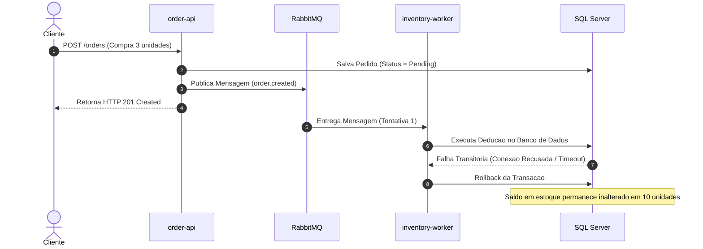

# Order Orchestrator

> **"O pedido foi aceito. Por que o saldo continua em 10?"**  
> Arquitetura de referencia em **.NET 10**, **C# 14**, **RabbitMQ**, **SQL Server** e **OpenTelemetry (Jaeger)** projetada para garantir consistencia eventual, deduplicacao idempotente de estoque e observabilidade distribuida entre processos.

---

## Sumario

- [Visao Geral do Projeto](#visao-geral-do-projeto)
- [O Problema Real de Negocio](#o-problema-real-de-negocio)
- [Objetivo do Projeto](#objetivo-do-projeto)
- [Arquitetura e Design](#arquitetura-e-design)
- [Diagrama de Interacao dos Componentes](#diagrama-de-interacao-dos-componentes)
- [Glossario do Negocio](#glossario-do-negocio)
- [Demonstracao Pratica: Cenario 10 -> 7 -> 7](#demonstracao-pratica-cenario-10---7---7)
- [Execucao Isolada por Fases](#execucao-isolada-por-fases)
- [Observabilidade com OpenTelemetry e Jaeger](#observabilidade-com-opentelemetry-e-jaeger)
- [Consultas SQL de Auditoria](#consultas-sql-de-auditoria)
- [Instrucoes de Execucao Local](#instrucoes-de-execucao-local)

---

## Visao Geral do Projeto

O **Order Orchestrator** e uma solucao corporativa para processamento distribuido de pedidos baseada no padrao arquitetural orientado a eventos (EDA - *Event-Driven Architecture*).

A solucao desacopla a camada de ingestao HTTP (**`order-api`**) do processamento assincrono de baixa de inventario (**`inventory-worker`**) em processos de sistema operacional distintos. O objetivo e fornecer resposta imediata ao usuario final enquanto a retaguarda assegura consistencia transacional, tolerancia a falhas e eliminacao de duplicidade de estoque (*overdeduction*).

---

## O Problema Real de Negocio

Em sistemas distribuidos de comercio eletronico, existe uma divergencia intrinseca entre o tempo de resposta da requisicao do cliente e o processamento seguro de inventario.



### Principais Riscos em Ambientes de Producao

1. **Assincronia sem Rastreabilidade**: A API confirma o recebimento com status `HTTP 201 Created`. No entanto, se o consumidor de retaguarda falhar na primeira tentativa de conexao com o banco, o saldo fisico permanece inalterado em 10 unidades. Sem instrumentacao tecnica, o operador de suporte nao consegue diagnosticar o motivo da retencao.
2. **Dupla Deducao de Estoque (*Overdeduction*)**: Infraestruturas de mensageria operam sob a garantia de entrega no minimo uma vez (*at-least-once delivery*). Caso o worker conclua a gravacao no banco mas encerre abruptamente antes de transmitir o sinal de reconhecimento (`ACK`) a fila, a mensagem sera reentregue. Sem um mecanismo rigido de idempotencia, o saldo sofreria uma segunda baixa indevida, caindo de 7 para 4.
3. **Condicoes de Corrida por Mensagens Paralelas**: Publicacoes duplicadas disparadas simultaneamente podem ser consumidas por threads paralelas. Sem isolamento relacional exclusivo, ambas podem calcular o saldo concorrentemente e corromper o estoque.

---

## Objetivo do Projeto

Demonstrar a implementacao das quatro garantias fundamentais da engenharia de software distribuida:

1. **Sequencia Transacional 10 -> 7 -> 7**:
   - **Saldo 10**: Pedido aceito pela API. A primeira tentativa no worker sofre falha transitoria simulada. O pedido exibe o erro e o saldo permanece intacto em 10.
   - **Saldo 7**: Apos liberacao da dependencia, o worker consome a reentrega e executa a baixa correta para 7 unidades.
   - **Saldo 7 (Idempotente)**: Uma queda pós-commit e pré-ACK e simulada. O RabbitMQ reentrega o evento com o mesmo identificador (`EventId`). O worker identifica o processamento previo, confirma o `ACK` e ignora nova deducao, mantendo o saldo estritamente em 7.
2. **Atomicidade Relacional no SQL Server**:
   A baixa de estoque, o registro da chave de deduplicacao na tabela `ProcessedEvents` e a mudanca de estado do pedido sao executados sob a mesma transacao relacional (`SqlTransaction`).
3. **ACK Estritamente Pos-Commit**:
   O envio de `BasicAckAsync` ao RabbitMQ e realizado apenas apos o encerramento com sucesso do commit fisico no banco de dados.
4. **Propagacao de Contexto W3C (OpenTelemetry)**:
   A requisicao HTTP original e as tentativas de consumo compartilham o mesmo `TraceId` atraves dos cabecalhos da mensageria, com geracao de `SpanId` exclusivo por tentativa.

---

## Arquitetura e Design

A solucao adota padroes formais de desenvolvimento:

- **Clean Architecture & Domain-Driven Design (DDD)**: Camadas estritas de Dominio, Aplicacao, Infraestrutura, Apresentacao e Worker.
- **Idempotent Consumer Pattern**: Uso da tabela `ProcessedEvents` com chave primaria composta `(ConsumerName, EventId)`. A restricao unica do banco de dados atua como barreira contra baixas duplicadas.
- **Politica de Retentativas com Dead Letter Queue (DLQ)**: Tratamento de erros transitorios via cabecalho de controle (`x-attempt-count`) com limite de 3 tentativas e roteamento automatico para a fila `inventory-dlq` em caso de falha permanente.
- **Separacao de Processos de Execucao**: A API Web e o Worker operam como executaveis .NET desacoplados para simular a distribuicao de servicos em producao.

---

## Diagrama de Interacao dos Componentes

O fluxo de dados entre os componentes ocorre de forma hierarquica conforme ilustrado:

```mermaid
graph TD
    subgraph Apresentacao["1. Camada de Apresentacao"]
        WebUI["Frontend Web Angular 22 (:4200)"]
        CLI["Scripts Automatizados PowerShell"]
    end

    subgraph Processo_API["2. Processo API: order-api (:5000)"]
        Endpoint["POST /orders (Minimal API)"]
        UseCase["CreateOrderUseCase"]
        ApiDb["AppDbContext (EF Core)"]
        Publisher["RabbitMqPublisher (Injeta W3C Headers)"]
    end

    subgraph Mensageria["3. Mensageria: RabbitMQ (:5672)"]
        TopicEx["Topic Exchange: order-events"]
        InvQueue["Fila: inventory-queue (order.created)"]
        DLX["Dead Letter Exchange: order-events.dlx"]
        DLQ["Fila de Falha Permanente: inventory-dlq"]
    end

    subgraph Processo_Worker["4. Processo Consumidor: inventory-worker"]
        Worker["InventoryWorker (BackgroundService)"]
        IdempotencyCheck["Verificacao de Idempotencia (ProcessedEvents)"]
        AtomicTx["Transacao SQL Atomica (Deducao + EventId + Pedido)"]
        AckHandler["Disparo de ACK (Pos-Commit)"]
    end

    subgraph Banco_Dados["5. Armazenamento Relacional: SQL Server (:1433)"]
        TblOrders[("Tabela Orders")]
        TblInventories[("Tabela Inventories")]
        TblProcessedEvents[("Tabela ProcessedEvents")]
    end

    subgraph Observabilidade["6. Observabilidade: OpenTelemetry"]
        Jaeger[("Painel Jaeger OTLP (:16686)")]
        ConsoleLogs["Logs Estruturados (TraceId / SpanId)"]
    end

    %% Relacoes de Chamada
    WebUI -->|1. Envia Pedido| Endpoint
    CLI -->|1. Envia Pedido| Endpoint

    Endpoint --> UseCase
    UseCase -->|2. Grava Pedido Pending| ApiDb
    ApiDb --> TblOrders

    UseCase -->|3. Publica Evento| Publisher
    Publisher -->|Injeta Headers W3C| TopicEx
    TopicEx --> InvQueue
    Endpoint -.->|4. Retorna HTTP 201 Created| WebUI

    InvQueue -->|5. Entrega Mensagem| Worker
    Worker -->|6. Extrai Contexto W3C| Jaeger
    Worker -->|7. Consulta Idempotencia| IdempotencyCheck
    IdempotencyCheck -.-> TblProcessedEvents

    Worker -->|8. Executa Transacao Atomica| AtomicTx
    AtomicTx --> TblInventories
    AtomicTx --> TblProcessedEvents
    AtomicTx --> TblOrders

    AtomicTx -->|9. Sucesso no Commit| AckHandler
    AckHandler -->|10. BasicAckAsync| InvQueue

    Worker -.->|Falha Permanente (Apos 3 tentativas)| DLX
    DLX --> DLQ

    Processo_API -.->|Spans de HTTP e Publicacao| Jaeger
    Processo_Worker -.->|Spans de Consumo e SQL| Jaeger
    Processo_Worker -.->|Logs com TraceId e SpanId| ConsoleLogs
```

---

## Glossario do Negocio

| Conceito | Descricao Tecnica e Aplicacao |
| :--- | :--- |
| **Pedido (`Order`)** | Entidade de negocio que representa a intencao de compra. Registrada inicialmente com status `Pending (1)`. |
| **Saldo Disponivel (`AvailableQuantity`)** | Saldo fisico disponivel para alocacao imediata na tabela `Inventories`. Saldo inicial de 10 unidades. |
| **Baixa de Estoque** | Atualizacao decremental do saldo disponivel equivalente a quantidade solicitada no pedido. |
| **`OrderId`** | Identificador UUID v7 da entidade de negocio do pedido. Permanece identico em reprocessamentos. |
| **`EventId`** | Identificador exclusivo do evento emitido. Utilizado como chave primaria de deduplicacao por consumidor. |
| **`ProcessedEvents`** | Tabela relacional com chave primaria composta `(ConsumerName, EventId)` responsavel pela garantia de idempotencia. |
| **Idempotencia** | Propriedade de uma operacao que pode ser aplicada multiplas vezes sem alterar o resultado alem da aplicacao inicial (**10 -> 7 -> 7**). |
| **Reentrega (`Redelivery`)** | Reenvio automatico de mensagem executado pelo RabbitMQ apos rejeicao, timeout ou queda de conexao com o worker. |
| **`BasicAckAsync`** | Confirmacao formal transmitida pelo consumidor a mensageria autorizando a remocao definitiva da mensagem. |
| **Falha Transitoria** | Indisponibilidade momentanea de infraestrutura (ex: perda temporaria de conexao com o banco), solucionavel por retentativas. |
| **Falha Permanente** | Inconsistencia irremediavel que direciona o evento a fila morta (`inventory-dlq`) para avaliacao do operador. |
| **`TraceId` e `SpanId`** | Metadados do padrao W3C Trace Context que correlacionam operacoes entre processos independentes no Jaeger. |

---

## Demonstracao Pratica: Cenario 10 -> 7 -> 7

O ciclo completo de validacao pode ser executado de forma automatizada via PowerShell:

```powershell
powershell -ExecutionPolicy Bypass -File ./scripts/run-full-demonstration.ps1
```

### Transicoes de Estado Executadas no Laboratorio

```mermaid
flowchart LR
    Fase1["Fase 1: Falha Transitoria<br/>Tentativa 1 com Erro"] -->|Saldo permanece| S1["Saldo: 10<br/>Status: Pending"]
    S1 --> Fase2["Fase 2: Recuperacao<br/>Tentativa 2 com Sucesso"]
    Fase2 -->|Deducao unica| S2["Saldo: 7<br/>Status: Processed"]
    S2 --> Fase3["Fase 3: Queda Pos-Commit<br/>Reentrega do mesmo EventId"]
    Fase3 -->|Deduplicacao atua| S3["Saldo: 7<br/>Baixa Duplicada Evitada"]
    S3 --> Fase4["Fase 4: Concorrencia Paralela<br/>2 envios no mesmo instante"]
    Fase4 -->|Chave unica garante| S4["Saldo: 7<br/>Apenas 1 deducao gravada"]
```



---

## Execucao Isolada por Fases

Caso seja necessario demonstrar ou auditar etapas pontuais:

### 1. Simular Falha Transitoria
```powershell
powershell -ExecutionPolicy Bypass -File ./scripts/simulate-transient-failure.ps1
```

### 2. Liberar Dependencia e Reprocessar
```powershell
powershell -ExecutionPolicy Bypass -File ./scripts/release-fault.ps1
```

### 3. Simular Queda Pos-Commit
```powershell
powershell -ExecutionPolicy Bypass -File ./scripts/simulate-post-commit-crash.ps1
```

### 4. Testar Concorrencia Paralela
```powershell
powershell -ExecutionPolicy Bypass -File ./scripts/test-parallel-resend.ps1
```

---

## Observabilidade com OpenTelemetry e Jaeger

O monitoramento centralizado esta disponivel localmente:

- **Painel Jaeger UI**: [http://localhost:16686](http://localhost:16686)
- **Localizacao dos Traces**: Selecionar os servicos `order-api` ou `inventory-worker` para visualizar a cadeia completa de spans.
- **Rastreamento de Tentativas**: Cada entrega do worker possui um `SpanId` especifico sob o mesmo `TraceId`, permitindo identificar a falha da primeira tentativa e o exito da subsequente.

### Formato de Log Estruturado
O console exibe correlacao W3C automatica:
```text
[11:45:22 ERR] [TraceId: a95d1796d191fbcc498875ea219fa640 SpanId: 5df9e0ec84ef9ce1] Falha transitoria: Conexao recusada na tentativa 1.
[11:45:24 INF] [TraceId: a95d1796d191fbcc498875ea219fa640 SpanId: 3c17849cb16f0ea9] [Tentativa 2] Estoque deduzido com sucesso para PROD-001. Novo saldo: 7.
```

---

## Consultas SQL de Auditoria

Execucao de consultas no SQL Server (`porta 1433`, usuario `sa`):

```sql
-- 1. Inspecao do saldo atual do produto
SELECT ProductId, AvailableQuantity, ReservedQuantity, UpdatedAt 
FROM Inventories 
WHERE ProductId = 'PROD-001';

-- 2. Inspecao dos eventos persistidos para deduplicacao
SELECT ConsumerName, EventId, OrderId, ProcessedAt 
FROM ProcessedEvents 
ORDER BY ProcessedAt DESC;

-- 3. Inspecao do historico de tentativas e erros do pedido
SELECT Id, Status, ProcessingAttempts, LastProcessingError, CreatedAt, UpdatedAt 
FROM Orders 
ORDER BY CreatedAt DESC;
```

---

## Instrucoes de Execucao Local

### 1. Inicializacao da Infraestrutura (Docker Compose)
Inicia os servicos de SQL Server, RabbitMQ e Jaeger:
```bash
docker compose up -d
```
- **SQL Server**: porta `1433`
- **RabbitMQ**: porta `5672` (Painel Web: `http://localhost:15672` - guest/guest)
- **Jaeger UI**: porta `16686`

### 2. Inicializacao da API (`order-api`)
```bash
dotnet run --project src/OrderOrchestrator.Api --launch-profile http
```
- Endpoint HTTP: `http://localhost:5000`
- Documentacao Swagger: `http://localhost:5000/swagger`

### 3. Inicializacao do Consumidor (`inventory-worker`)
Em um terminal dedicado:
```bash
dotnet run --project src/OrderOrchestrator.Worker
```

### 4. Inicializacao do Frontend Web (Opcional)
Em outro terminal:
```bash
cd src/OrderOrchestrator.Web
npm install
npm start
```
- Dashboard disponivel em: `http://localhost:4200`
