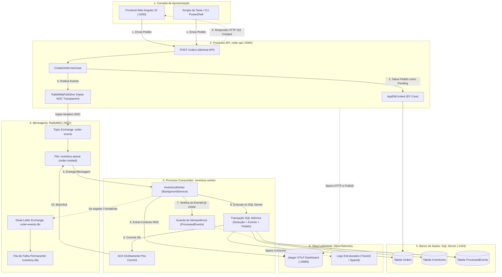

# Order Orchestrator

> **"O pedido foi aceito. Por que o saldo continua em 10?"**
> Uma arquitetura de referência em **.NET 10**, **C# 14**, **RabbitMQ**, **SQL Server** e **OpenTelemetry (Jaeger)** demonstrando como solucionar o problema real de consistência eventual, falhas assíncronas e evitar a dupla dedução de estoque (*overdeduction*) em sistemas distribuídos.

---

## 📌 O que é este projeto?

O **Order Orchestrator** é uma aplicação completa de mensageria e orquestração de pedidos em microsserviços. Ele separa a recepção do pedido (**`order-api`**) do processamento físico de estoque (**`inventory-worker`**) em processos independentes, garantindo que o cliente receba confirmação imediata enquanto a retaguarda processa com resiliência, idempotência estrita e rastreabilidade ponta a ponta.

---

## 🛑 O Problema Real do Mundo dos Negócios

Em plataformas de comércio eletrônico e sistemas orientados a eventos (EDA), existe um dilema clássico entre **velocidade para o cliente** e **consistência no estoque**:

```text
  [Cliente] ──(1. Comprar 3 un)──> [API] ──(2. Salva Pedido + Publica na Fila)──> [RabbitMQ]
                                     │
                                     └──(3. HTTP 201 Created!)──> [Cliente Feliz]
                                                                        │
                                                                   (Mas e o estoque?)
                                                                        ▼
                                                             [Worker Falha no Banco]
                                                                        ▼
                                                      O saldo de 10 NÃO baixou para 7!
```

### Os 3 Riscos Críticos em Produção:
1. **O Abismo da Assincronia**: A API responde **`HTTP 201 Created`** ao cliente em milissegundos. Porém, se o worker de estoque falhar por uma oscilação de rede ou queda do banco na primeira tentativa, a dedução física não ocorre e o saldo permanece em **10**. O cliente acha que comprou, mas o produto não foi baixado.
2. **O Risco da Dupla Baixa (*Overdeduction*)**: Filas de mensagens (RabbitMQ, Kafka, AWS SQS) garantem entrega no mínimo uma vez (*at-least-once delivery*). Se o worker salvar no banco mas cair uma fração de segundo antes de avisar a fila (ACK), a fila reentregará a mensagem. **Sem proteção de idempotência, o sistema baixaria novamente, reduzindo o saldo para 4 indevidamente!**
3. **Falta de Rastreabilidade**: Quando uma falha ocorre em um processo em segundo plano, os operadores de suporte não conseguem correlacionar a requisição HTTP original com o log do erro na fila.

---

## 🎯 O Objetivo deste Projeto

Demonstrar de forma prática, reproduzível e com 1 clique como resolver definitivamente esse problema com 4 garantias arquiteturais:

| Garantia | Como é resolvido na prática? |
| :--- | :--- |
| **1. A Sequência 10 → 7 → 7** | Mesmo que haja falha na 1ª tentativa e reentrega na 2ª e 3ª tentativas, a baixa ocorre **uma única vez**: o saldo inicia em **10**, recupera para **7** e, mesmo com reentrega forçada, permanece em **7** (nunca 4!). |
| **2. Transação Atômica no SQL Server** | A dedução do estoque, a inserção na tabela `ProcessedEvents` (chave única por consumidor e evento) e a atualização do pedido ocorrem sob a **mesma transação relacional**. |
| **3. ACK Estritamente Pós-Commit** | O consumidor só envia o `BasicAckAsync` ao RabbitMQ **após** o banco de dados confirmar o commit com sucesso. |
| **4. Rastreabilidade com OpenTelemetry** | A requisição HTTP na API e o consumo no Worker compartilham o mesmo `TraceId` via W3C (`traceparent`). O operador enxerga no Jaeger exatamente por que a tentativa 1 falhou e a tentativa 2 teve sucesso. |

---

## 🗺️ Fluxo Visual: Como os Componentes Interagem

### Diagrama de Hierarquia e Comunicação dos Componentes

O diagrama abaixo ilustra a arquitetura completa e o caminho percorrido pela mensagem:



---

## 📖 Glossário do Negócio

Conceitos essenciais explicados de forma simples e direta:

| Termo | Significado no Projeto |
| :--- | :--- |
| **Pedido (`Order`)** | Registro da compra criado pelo cliente. Nasce com status `Pending (1)`. |
| **Saldo Disponível (`AvailableQuantity`)** | Quantidade física pronta para entrega. Inicia com 10 unidades. |
| **Baixa de Estoque** | Subtração atômica da quantidade pedida do saldo disponível no banco de dados. |
| **`OrderId`** | Identificador de negócio do pedido (GUID v7). Não muda durante reprocessamentos. |
| **`EventId`** | Identificador único da mensagem/evento. Serve como base para a **deduplicação**. |
| **`ProcessedEvents`** | Tabela que guarda a chave primária `(ConsumerName, EventId)`. Garante que um consumidor nunca processe o mesmo evento duas vezes. |
| **Idempotência** | Propriedade que garante que executar uma ação várias vezes produz o mesmo efeito de executá-la uma única vez (**10 → 7 → 7**, e nunca **4**). |
| **Reentrega (`Redelivery`)** | Reenvio automático de uma mensagem não confirmada pelo RabbitMQ após falha ou queda do worker. |
| **`ACK` (`BasicAck`)** | Confirmação enviada à fila autorizando a remoção definitiva da mensagem. **Só ocorre após o commit no banco**. |
| **Falha Transitória** | Falha momentânea (ex: timeout de rede com o banco). Resolvida automaticamente via retentativa com backoff. |
| **`DLQ` (`Dead Letter Queue`)** | Fila de mensagens mortas (`inventory-dlq`). Recebe mensagens que falharam após o limite de 3 tentativas para análise do operador. |
| **`TraceId` & `SpanId`** | Identificadores W3C da telemetria. O `TraceId` acompanha a transação inteira; cada tentativa individual ganha um `SpanId` próprio. |

---

## 🚀 Demonstração Rápida: Cenário 10 → 7 → 7

Você pode validar todo o comportamento automaticamente executando um único comando no PowerShell:

```powershell
powershell -ExecutionPolicy Bypass -File ./scripts/run-full-demonstration.ps1
```

Esse script executa o ciclo completo em 4 fases:

```text
[Fase 1: Falha Transitória]   Saldo 10  ──(Tentativa 1 com Erro)──>  Saldo permanece em 10 (Pedido exibe erro)
[Fase 2: Recuperação]         Saldo 10  ──(Tentativa 2 com Sucesso)─>  Saldo baixa para 7
[Fase 3: Queda Pós-Commit]    Saldo 7   ──(Reentrega do mesmo EventId)─> Saldo continua em 7 (Deduplicação atua)
[Fase 4: Reenvio Concorrente] Saldo 10  ──(2 envios no mesmo instante)─> Saldo baixa para 7 (Apenas 1 baixa)
```

---

## 🔬 Passo a Passo Detalhado (Comandos Isolados)

Se quiser disparar e inspecionar cada fase individualmente:

### 1. Provocar a Falha Transitória (Saldo fica em 10)
Ativa a simulação de falha no worker e envia um pedido de 3 unidades do produto `PROD-001` (saldo inicial 10):
```powershell
powershell -ExecutionPolicy Bypass -File ./scripts/simulate-transient-failure.ps1
```
* **Resultado**: A API responde `HTTP 201 Created`. A tentativa 1 no worker falha antes do commit. O pedido registra `LastProcessingError` no banco e o **saldo de estoque continua em 10**!

### 2. Liberar a Dependência e Recuperar (Saldo vai para 7)
Desativa a falha simulada e aguarda a reentrega da mensagem:
```powershell
powershell -ExecutionPolicy Bypass -File ./scripts/release-fault.ps1
```
* **Resultado**: O worker processa a tentativa 2, deduz o estoque, grava em `ProcessedEvents`, atualiza o pedido para `Processed` e confirma com ACK. O **saldo vai para 7**!

### 3. Simular Queda Pós-Commit e Pré-ACK (Saldo continua em 7)
Simula o worker comitando no banco mas sofrendo queda antes de enviar o ACK para o RabbitMQ:
```powershell
powershell -ExecutionPolicy Bypass -File ./scripts/simulate-post-commit-crash.ps1
```
* **Resultado**: O RabbitMQ reentrega a mensagem com o mesmo `EventId`. O worker consulta a tabela `ProcessedEvents`, reconhece a duplicata, emite o ACK e não altera o estoque. O **saldo permanece em 7** (evitando o erro clássico de cair para 4).

### 4. Testar Reenvio Paralelo Simultâneo
Dispara 2 mensagens com o mesmo `EventId` exatamente ao mesmo tempo em threads concorrentes:
```powershell
powershell -ExecutionPolicy Bypass -File ./scripts/test-parallel-resend.ps1
```
* **Resultado**: O bloqueio por chave única no SQL Server impede concorrência e apenas 1 dedução é realizada. O **saldo final é 7**.

---

## 🔍 Observabilidade: Como o Operador Investiga?

### 1. Visualizador Jaeger UI
Abra no navegador: 👉 **[http://localhost:16686](http://localhost:16686)**

- **Trace Unificado**: Selecione `order-api` ou `inventory-worker` e visualize o fluxo completo da requisição HTTP até o consumo no worker.
- **Tentativas Distintas**: Cada tentativa de processamento recebe um `SpanId` exclusivo sob o mesmo `TraceId`. O operador visualiza a tentativa 1 com status vermelho de erro (e o stack trace) e a tentativa 2 com status verde de sucesso.

### 2. Logs Estruturados no Console
Cada mensagem de log inclui automaticamente o contexto de rastreio W3C:
```text
[11:45:22 ERR] [TraceId: a95d1796d191fbcc498875ea219fa640 SpanId: 5df9e0ec84ef9ce1] Falha transitória: Conexão recusada na tentativa 1.
[11:45:24 INF] [TraceId: a95d1796d191fbcc498875ea219fa640 SpanId: 3c17849cb16f0ea9] [Tentativa 2] Estoque deduzido com sucesso para PROD-001. Novo saldo: 7.
```

### 3. Consultas SQL de Evidência
Audite os dados diretamente no SQL Server (`sa` / `SqlAdmin#2026!Order` na porta `1433`):

```sql
-- 1. Verifica se o saldo final é exatamente 7
SELECT ProductId, AvailableQuantity, UpdatedAt FROM Inventories WHERE ProductId = 'PROD-001';

-- 2. Verifica a chave única gravada pelo consumidor
SELECT ConsumerName, EventId, OrderId, ProcessedAt FROM ProcessedEvents ORDER BY ProcessedAt DESC;

-- 3. Verifica o status do pedido, número de tentativas e erro registrado
SELECT Id, Status, ProcessingAttempts, LastProcessingError FROM Orders ORDER BY CreatedAt DESC;
```

---

## 💻 Como Executar o Ambiente Localmente

### 1. Iniciar Infraestrutura com Docker Compose
Sobe o SQL Server, RabbitMQ e Jaeger em segundo plano:
```bash
docker compose up -d
```
- **SQL Server**: `localhost:1433`
- **RabbitMQ**: `localhost:5672` (Painel Web: `http://localhost:15672` - guest/guest)
- **Jaeger UI**: `http://localhost:16686`

### 2. Iniciar a API (`order-api`)
```bash
dotnet run --project src/OrderOrchestrator.Api --launch-profile http
```
- Disponível em: `http://localhost:5000` (Swagger interativo em `/swagger`)

### 3. Iniciar o Worker de Estoque (`inventory-worker`)
Em um terminal separado:
```bash
dotnet run --project src/OrderOrchestrator.Worker
```

### 4. Iniciar o Frontend Web Angular (Opcional)
Em outro terminal:
```bash
cd src/OrderOrchestrator.Web
npm install
npm start
```
- Acesse o simulador gráfico em: `http://localhost:4200`
- Oferece botões visuais para disparar compras, forçar falhas e acompanhar os eventos em tempo real.
