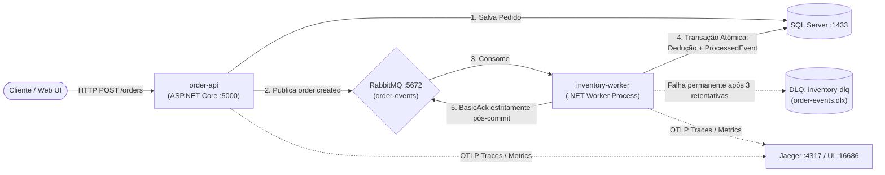

# O pedido foi aceito. Por que o saldo continua em 10?

Em arquiteturas orientadas a eventos (EDA), quando uma requisição HTTP chega à API para criar um pedido (`POST /orders`), a API valida o pedido, persiste o registro com status inicial `Pending (1)` e publica o evento `order.created` no RabbitMQ, retornando imediatamente **`HTTP 201 Created`** ao cliente.

Se o worker de estoque (`inventory-worker`) falhar logo na primeira tentativa — por exemplo, devido a uma indisponibilidade transitória de conexão com o banco de dados antes do commit — a transação de dedução sofre rollback. 

Como a mensageria é desacoplada e assíncrona:
1. **A resposta HTTP já enviada pela API não muda** (o cliente já recebeu `201 Created`).
2. **O saldo do produto no SQL Server permanece inalterado em 10**, pois a transação do worker não comitou.
3. **O operador descobre a causa imediatamente** através de três pilares de observabilidade e persistência:
   - **No estado do pedido (`Orders`)**: A coluna `LastProcessingError` armazena a mensagem da falha e `ProcessingAttempts` registra as tentativas executadas.
   - **No Jaeger (OpenTelemetry OTLP)**: O trace distribuído propaga o contexto W3C entre os processos `order-api` e `inventory-worker`, exibindo o span com erro `System.InvalidOperationException`, tags de erro e stack trace.
   - **Nos Logs Estruturados (`ILogger`)**: As mensagens contêm `TraceId`, `SpanId`, `OrderId` e `EventId` unificados.

Quando a dependência transitória é restabelecida, a política de reentrega do RabbitMQ reprocessa o evento. A transação atômica deduz o estoque, grava a chave única `(ConsumerName, EventId)` na tabela `ProcessedEvents`, atualiza o pedido para `Processed (2)`, realiza o commit no SQL Server e, **estritamente após o commit**, emite o `BasicAckAsync`. O saldo passa com segurança para **7**.

Caso ocorra uma falha drástica ou queda do processo após o commit e antes do ACK, o RabbitMQ reentregará a mensagem. O worker detectará a chave já persistida em `ProcessedEvents`, descartará a dedução duplicada e emitirá o ACK, mantendo o saldo estritamente em **7** (garantindo a sequência **10 → 7 → 7**).

---

## Sumário

- [O pedido foi aceito. Por que o saldo continua em 10?](#o-pedido-foi-aceito-por-que-o-saldo-continua-em-10)
- [Demonstração Rápida (Execução Guiada)](#demonstração-rápida-execução-guiada)
- [Roteiro Detalhado: Cenário 10 → 7 → 7](#roteiro-detalhado-cenário-10--7--7)
  - [1. Falha Transitória: Saldo permanece em 10](#1-falha-transitória-saldo-permanece-em-10)
  - [2. Liberação da Dependência e Recuperação: Saldo vai para 7](#2-liberação-da-dependência-e-recuperação-saldo-vai-para-7)
  - [3. Queda Pós-Commit e Pré-ACK: Reentrega e Saldo permanece em 7](#3-queda-pós-commit-e-pré-ack-reentrega-e-saldo-permanece-em-7)
  - [4. Reenvio Concorrente em Paralelo com o Mesmo EventId](#4-reenvio-concorrente-em-paralelo-com-o-mesmo-eventid)
- [Rastreamento Distribuído com OpenTelemetry e Jaeger](#rastreamento-distribuído-com-opentelemetry-e-jaeger)
- [Logs Estruturados e Métricas Agregadas](#logs-estruturados-e-métricas-agregadas)
- [Consultas SQL de Evidência](#consultas-sql-de-evidência)
- [Arquitetura em Processos Separados](#arquitetura-em-processos-separados)
- [Como Executar o Ambiente Completo](#como-executar-o-ambiente-completo)

---

## Demonstração Rápida (Execução Guiada)

Para executar a demonstração automatizada de ponta a ponta com todos os cenários (falha transitória, recuperação, queda pós-commit, idempotência 10 → 7 → 7 e reenvio concorrente em paralelo), execute o script:

```powershell
powershell -ExecutionPolicy Bypass -File ./scripts/run-full-demonstration.ps1
```

O script prepara o ambiente, injeta as falhas reproduzíveis, valida as consultas no SQL Server e exibe os links do Jaeger em tempo real.

---

## Roteiro Detalhado: Cenário 10 → 7 → 7

### 1. Falha Transitória: Saldo permanece em 10

Injeta uma falha transitória de banco de dados no worker e dispara um pedido de 3 unidades do produto `PROD-001` (saldo inicial 10):

```powershell
powershell -ExecutionPolicy Bypass -File ./scripts/simulate-transient-failure.ps1
```

**Comportamento observado:**
- A API retorna imediatamente `HTTP 201 Created` com `OrderId` e `EventId`.
- O worker consome a mensagem e simula falha de conexão com o banco antes do commit da dedução.
- A transação é abortada (rollback).
- O pedido tem seu status atualizado com o erro na tabela `Orders`:
  - `Status`: `Pending (1)`
  - `ProcessingAttempts`: `1`
  - `LastProcessingError`: `[Tentativa 1] Falha transitória simulada: Conexão com o SQL Server recusada/timeout na primeira tentativa.`
- **Saldo de `PROD-001` no banco:** **10 unidades** (sem dedução indevida).

---

### 2. Liberação da Dependência e Recuperação: Saldo vai para 7

Libere a falha para permitir que o worker reprocesse a mensagem:

```powershell
powershell -ExecutionPolicy Bypass -File ./scripts/release-fault.ps1
```

**Comportamento observado:**
- O worker recebe a mensagem na tentativa 2 (cabeçalho `x-attempt-count: 2`).
- A transação atômica no SQL Server executa:
  1. Dedução de 3 unidades do estoque de `PROD-001`.
  2. Inserção do registro de idempotência na tabela `ProcessedEvents` com a chave única composta `(ConsumerName: 'InventoryWorker', EventId: '<guid>')`.
  3. Atualização do pedido para `Status: Processed (2)`.
  4. `Commit` da transação no SQL Server.
- O worker executa o `BasicAckAsync` **estritamente após o commit**.
- **Saldo de `PROD-001` no banco:** **7 unidades**.

---

### 3. Queda Pós-Commit e Pré-ACK: Reentrega e Saldo permanece em 7

Simula o cenário crítico em que o banco já comitou a dedução e gravou `ProcessedEvents`, mas o processo sofre uma queda abrupta (ou perde a conexão de rede com o RabbitMQ) antes de enviar o ACK:

```powershell
powershell -ExecutionPolicy Bypass -File ./scripts/simulate-post-commit-crash.ps1
```

**Comportamento observado:**
- Na 1ª entrega: A transação comita no SQL Server (saldo vai para 7 e evento é gravado em `ProcessedEvents`). O worker simula queda e não envia o ACK (a mensagem é rejeitada com requeue).
- Na 2ª entrega: O RabbitMQ reentrega a mensagem com o **mesmo `EventId`**.
- O worker inicia uma nova tentativa, extrai o `EventId` e consulta a tabela `ProcessedEvents`.
- O registro já existe! O worker registra no log: `[Idempotency] Evento já foi processado com sucesso anteriormente. Ignorando dedução duplicada de estoque.`
- O worker emite o `BasicAckAsync` sem alterar o estoque.
- **Saldo de `PROD-001` no banco:** **7 unidades** (comprovando a sequência **10 → 7 → 7** sem duplicação de baixa).

---

### 4. Reenvio Concorrente em Paralelo com o Mesmo EventId

Testa a resiliência contra mensagens duplicadas disparadas simultaneamente em paralelo:

```powershell
powershell -ExecutionPolicy Bypass -File ./scripts/test-parallel-resend.ps1
```

**Comportamento observado:**
- Duas threads publicam concorrentemente a mesma mensagem com o mesmo `EventId`.
- Duas entregas simultâneas disputam a transação no SQL Server.
- A chave primária composta `(ConsumerName, EventId)` na tabela `ProcessedEvents` garante que apenas uma transação obtenha sucesso no commit.
- A transação concorrente sofre violação de chave única (SQL Error 2627/2601), é revertida de forma segura e recebe ACK como duplicata.
- **Saldo de `PROD-001` no banco:** **7 unidades** (apenas 1 dedução).

---

## Rastreamento Distribuído com OpenTelemetry e Jaeger

A solução implementa propagação de contexto W3C (`traceparent` e `tracestate`) através dos cabeçalhos do RabbitMQ, permitindo correlação completa ponta a ponta entre serviços em processos diferentes:

- **Interface do Jaeger UI**: [http://localhost:16686](http://localhost:16686)
- **Serviços instrumentados**:
  - `order-api`: Instrumentação HTTP ASP.NET Core, consultas SQL (`SqlClient`) e publicação RabbitMQ (`OrderOrchestrator.Messaging`).
  - `inventory-worker`: Consumo de mensagens RabbitMQ (`OrderOrchestrator.Messaging`), chamadas de banco (`SqlClient`) e métricas.

### Hierarquia de Spans

No fluxo simples de mensagem única, o worker extrai o contexto W3C e adota explicitamente o contexto de criação como pai (`SetParentId(parentContext.TraceId, parentContext.SpanId)`):

```text
[order-api] HTTP POST /orders
  │
  ├── [order-api] SqlClient: INSERT INTO Orders ...
  │
  └── [order-api] order-events publish (exchange: order-events, routing_key: order.created)
        │
        └── [inventory-worker] inventory-queue process (Tentativa 1 - SpanId A) -> ERROR (500)
              │
              └── [inventory-worker] inventory-queue process (Tentativa 2 - SpanId B) -> OK (200)
                    ├── [inventory-worker] SqlClient: SELECT Inventories ...
                    ├── [inventory-worker] SqlClient: INSERT INTO ProcessedEvents ...
                    └── [inventory-worker] SqlClient: UPDATE Orders SET Status = 2 ...
```

### Identificadores e Convenções

- `OrderId`: Identifica a entidade de negócio pedido.
- `EventId`: Identifica o evento de domínio e serve como base para deduplicação idempotente por consumidor na tabela `ProcessedEvents`.
- `TraceId`: Identificador técnico da operação distribuída, unificando os logs e spans da API e do Worker.
- `SpanId`: Cada tentativa de entrega no worker recebe um `SpanId` exclusivo.

---

## Logs Estruturados e Métricas Agregadas

### Logs Estruturados com Correlação
Tanto na API quanto no Worker, cada mensagem de log inclui automaticamente o contexto de telemetria ativo:

```text
[11:45:22 INF] [TraceId: a95d1796d191fbcc498875ea219fa640 SpanId: 5df9e0ec84ef9ce1] [InventoryWorker] Processando pedido 01a1a705-b416-778b-bf07-cc3640ab91a0 (Tentativa 1/3)
[11:45:22 ERR] [TraceId: a95d1796d191fbcc498875ea219fa640 SpanId: 5df9e0ec84ef9ce1] [InventoryWorker] Falha transitória simulada: Conexão com o SQL Server recusada/timeout na primeira tentativa.
[11:45:24 INF] [TraceId: a95d1796d191fbcc498875ea219fa640 SpanId: 3c17849cb16f0ea9] [InventoryWorker] [Tentativa 2] Estoque deduzido com sucesso para o produto PROD-001. Novo saldo: 7.
```

### Métrica Agregada de Tentativas por Resultado
O worker expõe a métrica agregada OpenTelemetry Meter `OrderOrchestrator.Inventory`:
- **Nome da Métrica**: `inventory.order.processing.attempts` (Counter)
- **Tags (Attributes)**:
  - `status`: `success` | `transient_error` | `duplicate_skipped` | `out_of_stock`
  - `product.id`: `PROD-001`
  - `attempt`: `1`, `2`, `3`

Enquanto as métricas agregadas mantêm a contagem estatística por dimensão, os identificadores individuais (`OrderId`, `EventId`) permanecem nos logs e nos spans do Jaeger.

---

## Consultas SQL de Evidência

As seguintes consultas no SQL Server comprovam o estado final e a integridade transacional:

### 1. Saldo do Produto
Confirma que o saldo final é exatamente 7 unidades:
```sql
SELECT ProductId, Name, AvailableQuantity, ReservedQuantity, UpdatedAt 
FROM Inventories 
WHERE ProductId = 'PROD-001';
```

### 2. Registro de Deduplicação por Consumidor
Confirma que a chave única composta `(ConsumerName, EventId)` foi gravada com sucesso:
```sql
SELECT ConsumerName, EventId, OrderId, ProcessedAt 
FROM ProcessedEvents 
ORDER BY ProcessedAt DESC;
```

### 3. Estado e Tentativas do Pedido
Confirma o status, o número de tentativas e o histórico de erro no próprio pedido:
```sql
SELECT Id, CustomerName, Status, ProcessingAttempts, LastProcessingError, CreatedAt, UpdatedAt 
FROM Orders 
ORDER BY CreatedAt DESC;
```

---

## Arquitetura em Processos Separados

A aplicação separa o publicador e o consumidor em processos com nomes de serviço distintos:



### Políticas de Resiliência e DLQ
1. **Quem detecta a falha:** O `inventory-worker` captura a exceção de execução durante o processamento da mensagem.
2. **Quem tenta novamente:** O próprio worker, ao detectar erro transitório, publica uma nova entrega na fila com `x-attempt-count` incrementado e backoff exponencial temporizado, emitindo ACK da mensagem anterior com erro para evitar loops imediatos de CPU.
3. **Destino de falha permanente (DLQ):** Após atingir o limite configurado (3 tentativas), o worker encaminha a mensagem com o histórico de erro para a dead-letter exchange `order-events.dlx`, armazenando-a na fila observável `inventory-dlq` para inspeção do operador.

---

## Como Executar o Ambiente Completo

### 1. Iniciar Infraestrutura com Docker Compose

Inicia o SQL Server, RabbitMQ e o Jaeger (coletor OTLP e UI):

```bash
docker compose up -d
```

- **SQL Server**: porta `1433` (sa / `SqlAdmin#2026!Order`)
- **RabbitMQ**: porta `5672` (AMQP) e `15672` (UI: `guest` / `guest`)
- **Jaeger UI**: porta `16686` (OTLP gRPC: `4317`, HTTP: `4318`)

### 2. Iniciar a API (`order-api`)

```bash
dotnet run --project src/OrderOrchestrator.Api --launch-profile http
```
- **API Base**: `http://localhost:5000`
- **Swagger**: `http://localhost:5000/swagger`

### 3. Iniciar o Worker de Estoque (`inventory-worker`)

Em um terminal separado:

```bash
dotnet run --project src/OrderOrchestrator.Worker
```

### 4. Iniciar o Frontend Angular (Opcional)

Em outro terminal:

```bash
cd src/OrderOrchestrator.Web
npm install
npm start
```
- **Dashboard Web**: `http://localhost:4200`
- Inclui painel interativo do Laboratório do Recorte com botões para simular a falha transitória, queda pós-commit e reset de cenário com 1 clique, além do link direto para o Jaeger.
