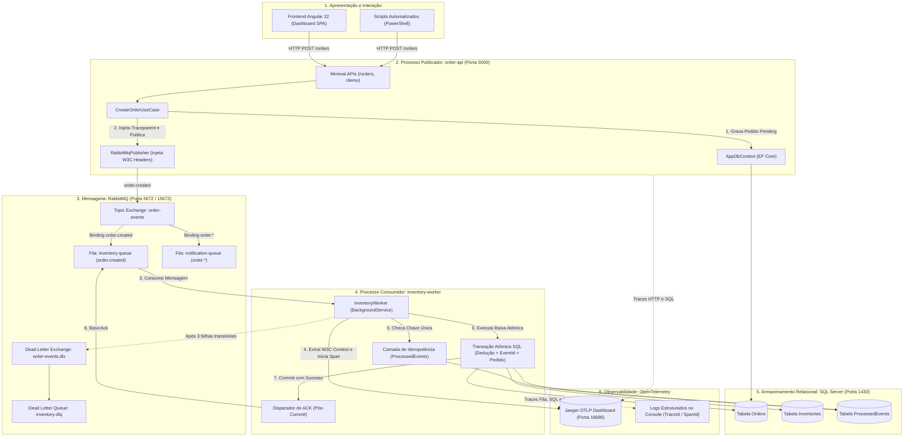
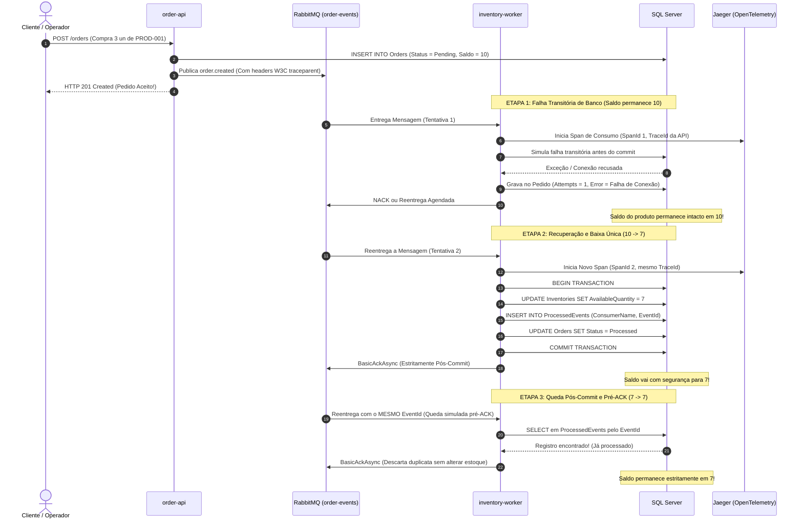

# O pedido foi aceito. Por que o saldo continua em 10?

Em sistemas modernos de comércio eletrônico e processamento distribuído, quando um cliente clica em "Finalizar Compra", a API responde em poucos milissegundos com **`HTTP 201 Created`**. O cliente vê na tela a mensagem de pedido confirmado. No entanto, ao consultar o estoque imediatamente no banco de dados, o operador percebe que o saldo do produto continua exatamente em **10 unidades** (não baixou para 7).

**Por que isso acontece?**
Em uma Arquitetura Orientada a Eventos (EDA), a API não faz a dedução direta de estoque na mesma requisição HTTP. Ela salva o pedido com status inicial `Pending (1)`, publica uma mensagem na fila (`order.created`) e libera o cliente. O trabalho pesado de reserva e dedução física é delegado a um processo trabalhador independente em segundo plano (`inventory-worker`).

Se esse trabalhador encontrar uma falha transitória logo na primeira tentativa — como uma oscilação na rede, concorrência no banco ou lentidão temporária — a transação de dedução é abortada (rollback):
1. **A resposta HTTP original não muda**: o cliente já recebeu `201 Created` e seu fluxo de navegação não é interrompido.
2. **O saldo continua em 10**: a transação falhou de forma segura antes do commit, evitando que números incorretos fiquem no banco.
3. **O operador descobre a causa na hora**:
   - **No estado do pedido (`Orders`)**: a coluna `LastProcessingError` exibe a mensagem da falha e `ProcessingAttempts` exibe as tentativas realizadas.
   - **No Jaeger (OpenTelemetry)**: o trace distribuído conecta a requisição HTTP da API ao span com erro no worker sob o mesmo `TraceId`.
   - **Nos logs estruturados**: o console traz `[TraceId: ... SpanId: ...]` com o stack trace completo.

Assim que a dependência é restabelecida, a fila reentrega a mensagem. O worker processa com sucesso, deduz o saldo para **7**, grava o registro de idempotência na tabela `ProcessedEvents` e atualiza o pedido para `Processed (2)` em uma única transação atômica no SQL Server. O `ACK` é emitido **estritamente após o commit**.

Se o processo sofrer uma queda abrupta logo após o commit e antes do ACK, a mensagem será reentregue. Ao chegar novamente, o worker consulta `ProcessedEvents`, detecta que o evento já foi processado e confirma o ACK sem baixar o estoque de novo. O saldo permanece rigorosamente em **7** (garantindo a sequência **10 → 7 → 7**).

---

## Sumário

- [O que este projeto é e qual problema resolve?](#o-que-este-projeto-é-e-qual-problema-resolve)
- [Glossário do Negócio (Entenda em Poucas Palavras)](#glossário-do-negócio-entenda-em-poucas-palavras)
- [Arquitetura e Design de Software](#arquitetura-e-design-de-software)
- [Fluxo Visual dos Componentes (Diagramas Mermaid)](#fluxo-visual-dos-componentes-diagramas-mermaid)
  - [1. Hierarquia e Interação dos Componentes](#1-hierarquia-e-interação-dos-componentes)
  - [2. Diagrama de Sequência e Fronteira Transacional](#2-diagrama-de-sequência-e-fronteira-transacional)
- [Demonstração Rápida (Execução Guiada)](#demonstração-rápida-execução-guiada)
- [Roteiro Detalhado: Cenário 10 → 7 → 7](#roteiro-detalhado-cenário-10--7--7)
  - [1. Falha Transitória: Saldo permanece em 10](#1-falha-transitória-saldo-permanece-em-10)
  - [2. Liberação da Dependência e Recuperação: Saldo vai para 7](#2-liberação-da-dependência-e-recuperação-saldo-vai-para-7)
  - [3. Queda Pós-Commit e Pré-ACK: Reentrega e Saldo permanece em 7](#3-queda-pós-commit-e-pré-ack-reentrega-e-saldo-permanece-em-7)
  - [4. Reenvio Concorrente em Paralelo com o Mesmo EventId](#4-reenvio-concorrente-em-paralelo-com-o-mesmo-eventid)
- [Observabilidade: OpenTelemetry, Jaeger e Logs](#observabilidade-opentelemetry-jaeger-e-logs)
- [Consultas SQL de Evidência](#consultas-sql-de-evidência)
- [Como Executar o Ambiente Completo](#como-executar-o-ambiente-completo)

---

## O que este projeto é e qual problema resolve?

### O Propósito
Este projeto é um laboratório prático de engenharia de software demonstrando como construir **orquestração de pedidos resiliente e observável** usando **.NET 10, C# 14, RabbitMQ, SQL Server e OpenTelemetry**.

### O Problema que Resolve
Em sistemas distribuídos com mensageria, surgem três desafios graves do mundo real:
1. **O Abismo da Assincronia**: Quando a API aceita o pedido, mas o processamento de retaguarda falha em silêncio, gerando divergência entre o que o cliente vê e o estoque real.
2. **O Risco da Dupla Baixa (Overdeduction)**: Protocolos de mensageria como AMQP garantem entrega no mínimo uma vez (*at-least-once delivery*). Isso significa que reentregas de rede, quedas de workers ou reprocessamentos podem entregar a mesma mensagem duas vezes. Sem um design estrito, um produto de saldo 10 sofreria duas baixas de 3 unidades, caindo incorretamente para 4 em vez de 7!
3. **Condições de Corrida em Paralelo**: Mensagens duplicadas enviadas simultaneamente podem ser consumidas em paralelo por diferentes threads. Sem bloqueio transacional único, ambas poderiam ler o saldo ao mesmo tempo e deduzir duas vezes.
4. **Falta de Rastreabilidade entre Processos**: Quando o erro acontece em um worker secundário, operadores muitas vezes não conseguem ligar a requisição HTTP original ao log de erro na fila.

### A Solução Implementada
- **Separação Física de Processos**: API publicadora (`order-api`) e trabalhador de estoque (`inventory-worker`) operando como processos independentes.
- **Transação Atômica Relacional**: A dedução do estoque, a gravação da chave de deduplicação `(ConsumerName, EventId)` e a atualização do estado do pedido ocorrem sob a **mesma transação SQL Server**. Se algo falhar, tudo volta (rollback).
- **ACK Estritamente Pós-Commit**: A confirmação de recebimento para o RabbitMQ (`BasicAckAsync`) só é disparada depois que o banco garantiu o commit físico no disco.
- **Deduplicação Idempotente**: Se o mesmo `EventId` for entregue novamente (por reentrega ou em paralelo), o worker reconhece o evento já gravado e descarta a dedução.
- **Propagação W3C Distribuída**: O contexto de rastreio (`traceparent`) viaja nos cabeçalhos da mensagem RabbitMQ, unificando os spans no Jaeger UI e nos logs estruturados.

---

## Glossário do Negócio (Entenda em Poucas Palavras)

| Termo | O que significa na prática? |
| :--- | :--- |
| **Pedido (`Order`)** | Registro da intenção de compra do cliente (contém cliente, produto, quantidade e valor total). |
| **Saldo Disponível (`AvailableQuantity`)** | Quantidade real de itens de um produto em estoque pronta para venda física. |
| **Baixa de Estoque (`Stock Deduction`)** | Ação de subtrair a quantidade comprada do saldo disponível do produto no banco de dados. |
| **Evento de Domínio (`OrderCreatedEvent`)** | Notificação enviada pelo sistema avisando: *"O pedido X foi criado e precisa de tratamento"*. |
| **`OrderId`** | Identificador de negócio único do pedido (ex: `01a1a705-b416-778b...`). |
| **`EventId`** | Identificador único do evento de mensageria. É a base da deduplicação por consumidor. |
| **`TraceId`** | Código que acompanha a operação por todos os serviços (da API ao Worker e ao Banco) no Jaeger. |
| **`SpanId`** | Identificador de um passo específico dentro da operação. Cada tentativa de entrega ganha seu próprio `SpanId`. |
| **Idempotência** | Propriedade que garante que processar uma ação várias vezes produz exatamente o mesmo resultado de processá-la uma única vez (ex: **10 → 7 → 7** e nunca **4**). |
| **Reentrega (`Redelivery`)** | Quando o RabbitMQ entrega novamente uma mensagem que não recebeu confirmação de sucesso anterior. |
| **`ACK` (`Acknowledge`)** | Confirmação enviada pelo consumidor ao RabbitMQ dizendo: *"Mensagem processada e salva no banco, pode removê-la da fila"*. |
| **`NACK` (`Negative ACK`)** | Aviso enviado ao RabbitMQ dizendo: *"Houve um erro, requeira ou reenvie a mensagem"*. |
| **Falha Transitória** | Erro temporário e recuperável (ex: queda momentânea de conexão com o banco). Resolve-se tentando novamente. |
| **Falha Permanente** | Erro que nunca se resolverá sozinho (ex: produto não cadastrado, payload inválido). Vai para a fila de erros. |
| **`DLQ` (`Dead Letter Queue`)** | "Fila de descarte / cemitério" onde mensagens que esgotaram todas as tentativas são guardadas para análise humana. |

---

## Arquitetura e Design de Software

O projeto segue padrões consolidados de engenharia de software distribuída:

- **Clean Architecture & DDD**: Separação clara entre Domínio (`Domain`), Casos de Uso (`Application`), Infraestrutura (`Infrastructure`), API Web (`Api`) e Trabalhador em Segundo Plano (`Worker`).
- **Padrão Consumidor Idempotente (*Idempotent Consumer Pattern*)**: Utilização da tabela `ProcessedEvents` com chave primária composta `(ConsumerName, EventId)`. A restrição única do banco de dados atua como guardiã intransponível contra baixas duplicadas.
- **Fronteira Transacional Atômica**:
  $$\text{Transação SQL} = [\text{Dedução de Estoque}] + [\text{Inserção em ProcessedEvents}] + [\text{Atualização do Pedido}]$$
  Nenhuma dessas operações existe sem as outras duas.
- **Política de Reentrega Bounded com Backoff**: Em caso de falha transitória, o worker gerencia as tentativas com cabeçalho de contagem (`x-attempt-count`) e pausa progressiva. Ao atingir o limite (3 tentativas), desvia automaticamente para a DLQ (`inventory-dlq`).
- **OpenTelemetry Semantic Conventions**: Instrumentação seguindo os padrões oficiais da W3C e OpenTelemetry para sistemas de mensageria (`messaging.system`, `messaging.destination.name`, `messaging.operation`).

---

## Fluxo Visual dos Componentes (Diagramas Mermaid)

### 1. Hierarquia e Interação dos Componentes

O diagrama abaixo ilustra como as camadas e serviços se organizam e se comunicam:



---

### 2. Diagrama de Sequência e Fronteira Transacional

O diagrama abaixo detalha a ordem cronológica, destacando a fronteira onde o erro ocorre na 1ª tentativa e a recuperação com proteção de idempotência nas etapas seguintes:



---

## Demonstração Rápida (Execução Guiada)

Para validar todos os requisitos em uma única execução automatizada no terminal, execute:

```powershell
powershell -ExecutionPolicy Bypass -File ./scripts/run-full-demonstration.ps1
```

O script executa automaticamente os quatro passos do laboratório, aguarda os tempos de processamento, consulta o banco SQL Server e valida se o saldo respeitou **10 → 7 → 7**.

---

## Roteiro Detalhado: Cenário 10 → 7 → 7

Caso prefira inspecionar cada comportamento de forma isolada, siga os passos abaixo:

### 1. Falha Transitória: Saldo permanece em 10

Injeta a falha simulada de conexão no worker e cria um pedido de 3 unidades do produto `PROD-001` (saldo inicial 10):

```powershell
powershell -ExecutionPolicy Bypass -File ./scripts/simulate-transient-failure.ps1
```

**O que observar:**
- A API retorna imediatamente `HTTP 201 Created` informando `OrderId` e `EventId`.
- O worker tenta processar, encontra o erro simulado e aborta a transação.
- O pedido registra o erro na tabela `Orders` (`Status = Pending`, `ProcessingAttempts = 1`, `LastProcessingError = Falha transitória...`).
- **Saldo no Banco:** **10 unidades** (nenhuma dedução indevida ocorreu).

---

### 2. Liberação da Dependência e Recuperação: Saldo vai para 7

Libere a falha para que o worker consiga comitar no banco de dados:

```powershell
powershell -ExecutionPolicy Bypass -File ./scripts/release-fault.ps1
```

**O que observar:**
- O worker consome a mensagem na tentativa 2 (`x-attempt-count: 2`).
- A transação atômica executa a dedução do saldo, insere o registro em `ProcessedEvents` e atualiza o pedido para `Status = Processed`.
- O commit é confirmado no banco e o `BasicAckAsync` é emitido para o RabbitMQ.
- **Saldo no Banco:** **7 unidades**.

---

### 3. Queda Pós-Commit e Pré-ACK: Reentrega e Saldo permanece em 7

Simula o cenário mais perigoso de sistemas distribuídos: o banco comitou com sucesso, mas o worker sofreu uma queda ou perda de conexão antes de enviar o ACK para o RabbitMQ:

```powershell
powershell -ExecutionPolicy Bypass -File ./scripts/simulate-post-commit-crash.ps1
```

**O que observar:**
- Na 1ª tentativa: o saldo vai para 7 e o evento é gravado em `ProcessedEvents`. O worker simula a queda e não dá ACK.
- Na 2ª tentativa: o RabbitMQ reentrega a mensagem com o **mesmo `EventId`**.
- O worker consulta `ProcessedEvents`, detecta que o evento já foi finalizado anteriormente, registra no log que pulou a dedução duplicada e emite o ACK.
- **Saldo no Banco:** **7 unidades** (comprovando a sequência **10 → 7 → 7** e prevenindo saldo 4).

---

### 4. Reenvio Concorrente em Paralelo com o Mesmo EventId

Testa a proteção do banco quando duas mensagens com o mesmo `EventId` chegam exatamente no mesmo milissegundo em threads paralelas:

```powershell
powershell -ExecutionPolicy Bypass -File ./scripts/test-parallel-resend.ps1
```

**O que observar:**
- Duas threads disparam a publicação simultânea da mesma mensagem.
- Ambas competem pelo commit no SQL Server.
- A chave primária `(ConsumerName, EventId)` em `ProcessedEvents` garante que apenas uma transação obtenha êxito. A transação concorrente sofre violação de chave única (SQL Error 2627), faz rollback seguro e é confirmada sem causar dupla baixa.
- **Saldo no Banco:** **7 unidades**.

---

## Observabilidade: OpenTelemetry, Jaeger e Logs

### Visualização no Jaeger UI
Acesse o painel do Jaeger no navegador:
👉 **[http://localhost:16686](http://localhost:16686)**

- **Buscar Traces**: Selecione o serviço `order-api` ou `inventory-worker` e clique em *Find Traces*.
- **Visão Ponta a Ponta**: Você verá um único trace correlacionado contendo a requisição HTTP da API, a publicação no RabbitMQ, o consumo no Worker e as queries SQL do EF Core.
- **Tentativas Distintas**: Cada tentativa de processamento aparece com um `SpanId` exclusivo sob o mesmo `TraceId`, permitindo comparar a tentativa 1 (com erro) e a tentativa 2 (com sucesso).

### Logs Estruturados
Os logs exibem o contexto W3C injetado automaticamente:
```text
[11:45:22 INF] [TraceId: a95d1796d191fbcc498875ea219fa640 SpanId: 5df9e0ec84ef9ce1] [InventoryWorker] Processando pedido 01a1a705-b416-778b-bf07-cc3640ab91a0 (Tentativa 1/3)
[11:45:22 ERR] [TraceId: a95d1796d191fbcc498875ea219fa640 SpanId: 5df9e0ec84ef9ce1] [InventoryWorker] Falha transitória simulada: Conexão com o SQL Server recusada na tentativa 1.
[11:45:24 INF] [TraceId: a95d1796d191fbcc498875ea219fa640 SpanId: 3c17849cb16f0ea9] [InventoryWorker] [Tentativa 2] Estoque deduzido com sucesso para PROD-001. Novo saldo: 7.
```

### Métrica Agregada de Tentativas
Métrica exportada via OTLP (`OrderOrchestrator.Inventory`):
- **Nome**: `inventory.order.processing.attempts`
- **Dimensões (Tags)**: `status` (`success`, `transient_error`, `duplicate_skipped`), `product.id`, `attempt`.

---

## Consultas SQL de Evidência

Você pode executar as consultas abaixo em qualquer ferramenta SQL (SSMS, Azure Data Studio, VS Code mssql) para auditar os dados:

### 1. Saldo do Produto
Confirma que o saldo final é exatamente 7:
```sql
SELECT ProductId, Name, AvailableQuantity, ReservedQuantity, UpdatedAt 
FROM Inventories 
WHERE ProductId = 'PROD-001';
```

### 2. Registro de Deduplicação por Consumidor
Confirma a chave única gravada atomicamente:
```sql
SELECT ConsumerName, EventId, OrderId, ProcessedAt 
FROM ProcessedEvents 
ORDER BY ProcessedAt DESC;
```

### 3. Histórico e Erro do Pedido
Confirma que o erro do worker ficou visível na entidade do pedido:
```sql
SELECT Id, CustomerName, Status, ProcessingAttempts, LastProcessingError, CreatedAt, UpdatedAt 
FROM Orders 
ORDER BY CreatedAt DESC;
```

---

## Como Executar o Ambiente Completo

### 1. Iniciar os Contêineres (Docker Compose)
Inicia o SQL Server, RabbitMQ e Jaeger:
```bash
docker compose up -d
```
- **SQL Server**: porta `1433` (sa / `SqlAdmin#2026!Order`)
- **RabbitMQ**: porta `5672` (AMQP) e `15672` (Management: `guest` / `guest`)
- **Jaeger**: porta `16686` (UI) e `4317` (OTLP gRPC)

### 2. Iniciar a API (`order-api`)
```bash
dotnet run --project src/OrderOrchestrator.Api --launch-profile http
```
- A API responde em `http://localhost:5000`
- Documentação interativa Swagger: `http://localhost:5000/swagger`

### 3. Iniciar o Worker de Estoque (`inventory-worker`)
Em um terminal separado:
```bash
dotnet run --project src/OrderOrchestrator.Worker
```

### 4. Iniciar o Frontend Angular (Opcional)
Em outro terminal:
```bash
cd src/OrderOrchestrator.Web
npm install
npm start
```
- Acesse o painel interativo em `http://localhost:4200`
- Inclui botões para disparo de simulações com 1 clique, visualizador gráfico de fluxo Pub/Sub em tempo real e atalho direto para o Jaeger.
